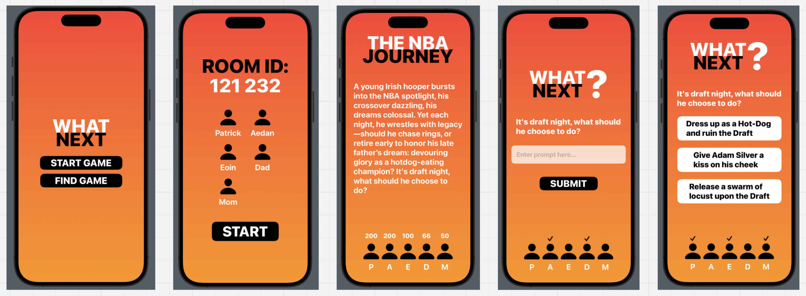

# What's Next? 
A turn-based narrative adventure game where an AI Game Master creates a unique story for you and your friends.




## Overview

Gather 2-4 players and embark on a collaborative storytelling experience. An AI Game Master dynamically crafts your adventure based on your group's choices, creating branching narratives and unexpected challenges unique to each playthrough.

## Features

- **AI-Powered Storytelling** - A living narrative that adapts to your decisions
- **Multiplayer Party System** - 2-4 players cooperate in turn-based gameplay
- **Dynamic Choices** - Every decision shapes your journey
- **Unique Adventures** - No two playthroughs are the same

## Requirements

- iOS 15.0+
- Swift 5.0+
- Xcode 13.0+

## Getting Started
```swift
// TODO: Add installation and setup instructions
```

## How to Play

1. Gather your party of 2-4 players
2. The AI Game Master sets the scene
3. Take turns making decisions as a group
4. Watch your unique story unfold

---

Built with Swift | Powered by AI
